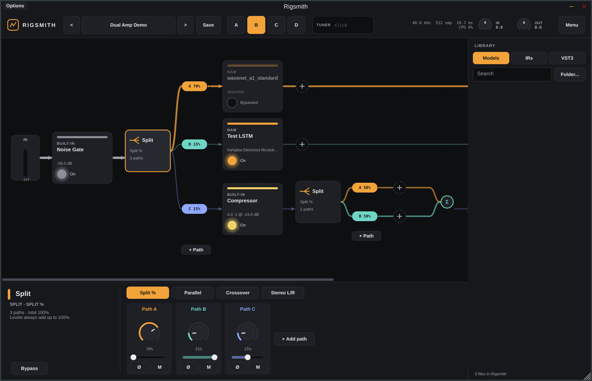

# Rigsmith

A standalone Windows guitar rig built around **Neural Amp Modeler**, with a flexible routing system and a VST3 host — shipped as both **`Rigsmith.exe`** and **`Rigsmith.vst3`** from one codebase.



## Features

**Amp & cab**
- **NAM built in** (NeuralAmpModelerCore): WaveNet, LSTM, ConvNet, A2 and more. Drop a `.nam` file on a block, or double-click it.
- Automatic **resampling** when a model's rate differs from your interface (e.g. a 48 kHz model at 44.1 or 96 kHz).
- **Loudness normalisation** so models are level-matched, plus a post-amp tone stack (bass, middle, treble, presence).
- **Cab IR loader** with low/high cut, mix and level.

**Routing**
- **Splits with up to 6 paths**, nestable to any depth — a split inside a path inside a split.
- Four split modes:
  - **Split %**: one signal shared out; moving one path rebalances the others so the total stays 100%.
  - **Parallel**: every path gets the full signal, with optional auto gain compensation.
  - **Crossover**: Linkwitz-Riley band split (lows / mids / highs), allpass-compensated so it sums flat.
  - **Stereo L/R**: classic wide dual-amp rig.
- Per-path **level, pan, polarity flip, mute and solo**.
- **Automatic latency alignment**: paths with different plug-in latency stay in time, so blends don't comb-filter.
- Wire thickness shows how much signal each path carries.

**Hosting & live use**
- Hosts any **VST3** effect. Plug-in state is saved in your presets, and a missing plug-in keeps its settings until you reinstall it.
- **Scenes A–D**: per-scene bypass, path levels and mutes, with click-free crossfades.
- **MIDI learn** for footswitches and expression pedals: scenes, bypass, path levels, an A/B amp blend, any knob, next/previous preset, tuner and master volume. Program Change selects presets.
- **Tuner** with a mute option; built-in noise gate, compressor, studio EQ and volume/pan blocks.
- Presets are `.rig` files in `Documents\Rigsmith\Presets`; sub-folders show up as banks.
- Output safety limiter, input routing (input 1, input 2, summed or stereo) and input/output gain.

## Download

Every push builds on GitHub Actions. Open the **Actions** tab, pick the latest run, and download **Rigsmith-Windows**. It contains:

- **`Rigsmith-x.y.z-Setup.exe`**: installs the app, adds a Start-menu shortcut and puts the VST3 in `C:\Program Files\Common Files\VST3`.
- **`Rigsmith-x.y.z-windows.zip`**: a portable copy of `Rigsmith.exe` and `Rigsmith.vst3`.

To publish a GitHub Release, push a tag:

```
git tag v0.1.0 && git push origin v0.1.0
```

## Quick start

1. Run Rigsmith. Open **Menu → Audio / MIDI settings**, choose your interface's **ASIO** driver (or WASAPI) and set a small buffer (64–128 samples).
2. Choose your guitar input under **Menu → Guitar input** (input 1 by default).
3. In the **Library**, click **Folder…** and point it at your `.nam` models, then do the same for IRs. Free models are on [TONE3000](https://www.tone3000.com).
4. Drag a model onto the **NAM Amp** block and an IR onto **Cab IR**.
5. Click **+** anywhere in the chain to add blocks, splits or VST3s. Scan for VST3s first with **Library → VST3 → Scan…**.

### Working with the rig

| Action | How |
|---|---|
| Bypass a block | Click its footswitch, or select it and press `Space` |
| Reorder a block | Drag it, including into or out of a split's paths |
| Set a path's level | Drag its coloured pill up or down, or use the inspector |
| Mute a path | Double-click its pill |
| More options | Right-click any block, pill, scene or knob |
| MIDI learn | Right-click a control, choose **MIDI learn**, then press a footswitch or move a pedal |
| Switch scenes | Keys `1`–`4` |
| Change presets | `Page Up` / `Page Down` |
| Save | `Ctrl+S` |
| Tuner | `T` |

## Building from source

Requirements: CMake 3.25+ and Visual Studio 2022 or later with the C++ workload. JUCE 9 and NeuralAmpModelerCore are downloaded automatically.

```
cmake -S . -B build -A x64
cmake --build build --config Release --target Rigsmith_Standalone Rigsmith_VST3
```

The outputs land in `build/Rigsmith_artefacts/Release/Standalone` and `.../VST3`.

Headless engine tests run on Linux or Windows:

```
cmake -S . -B build -DRIGSMITH_TESTS=ON
cmake --build build --target RigsmithTests
build/RigsmithTests_artefacts/Release/RigsmithTests build/_deps/namcore-src/example_models
```

## Project layout

```
Source/
  Engine/   audio graph: Node, Chain, Split, NAM/IR/Gate/Comp/EQ/Gain blocks,
            VST3 hosting, scenes, MIDI, presets, tuner (no UI code)
  UI/       look & feel, graph view, inspector, library, header
  PluginProcessor.*  /  PluginEditor.*   JUCE glue shared by the exe and the VST3
Tests/      headless engine tests
installer/  Inno Setup script used by CI
```

## Licence

Rigsmith is released under the **GNU AGPLv3** (see `LICENSE`), because it's built on the open-source edition of [JUCE](https://juce.com), which is AGPLv3. Distributing a closed-source build would require a commercial JUCE licence.

NeuralAmpModelerCore is © Steven Atkinson, MIT licence. VST is a registered trademark of Steinberg Media Technologies GmbH.
