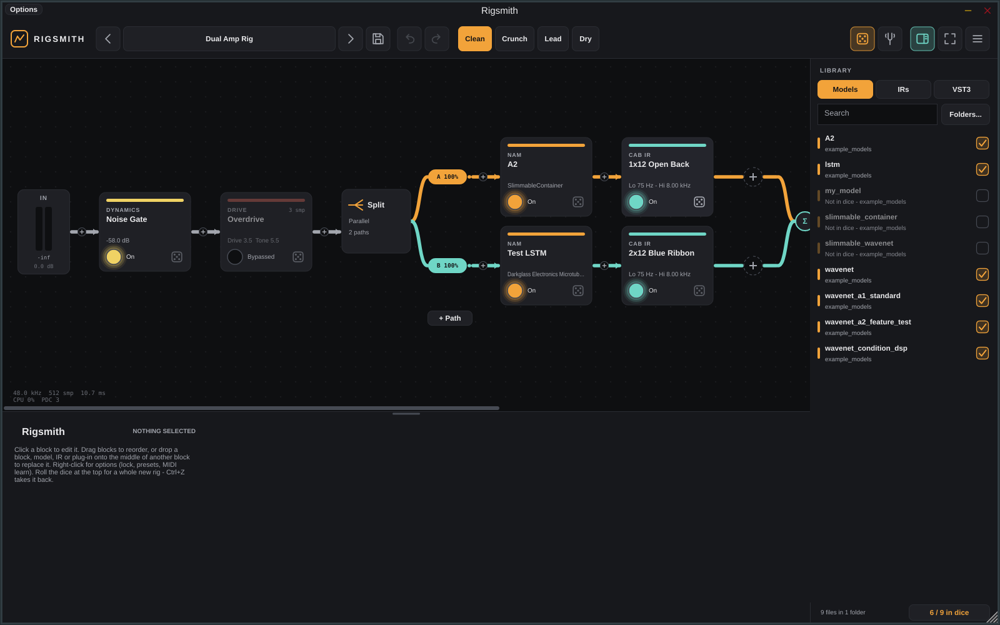
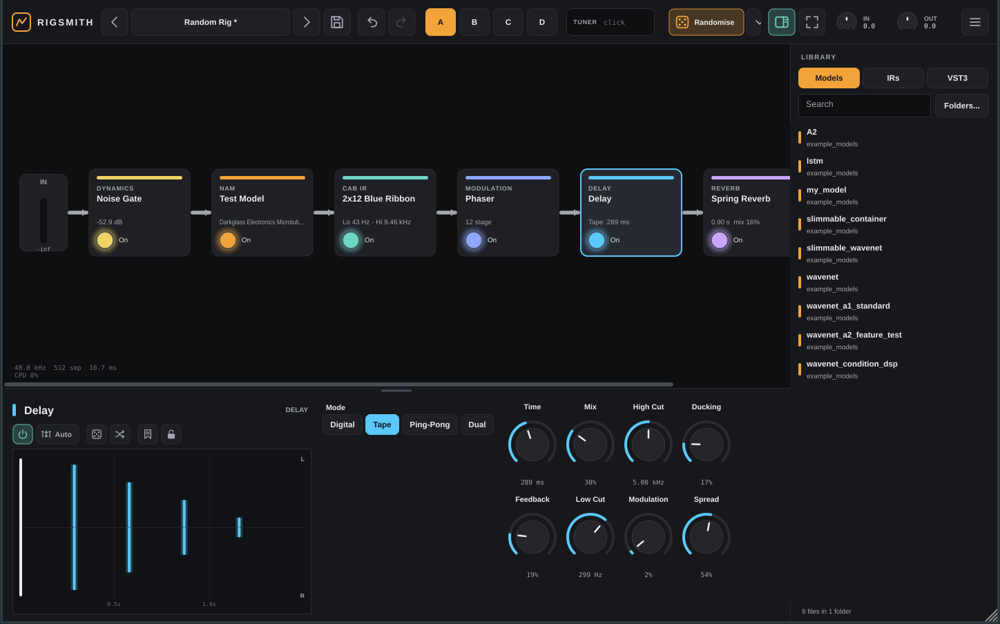
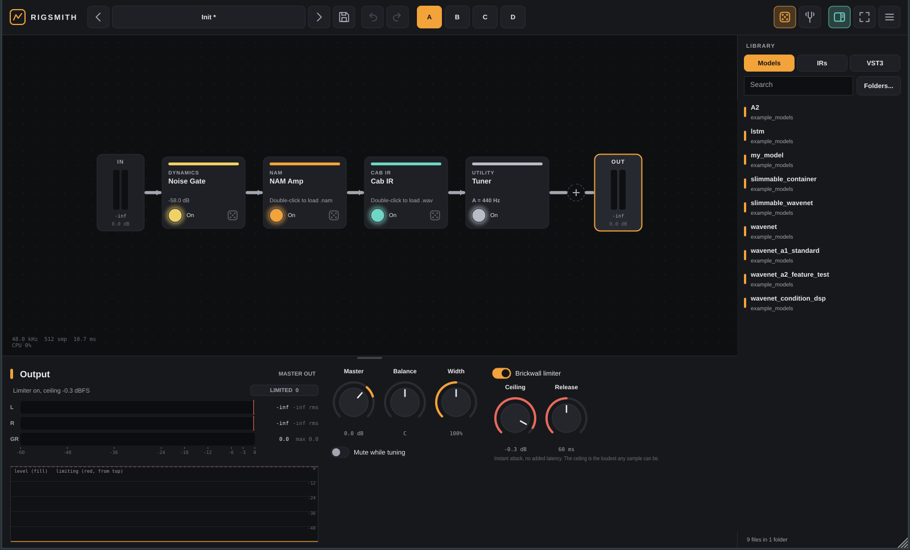
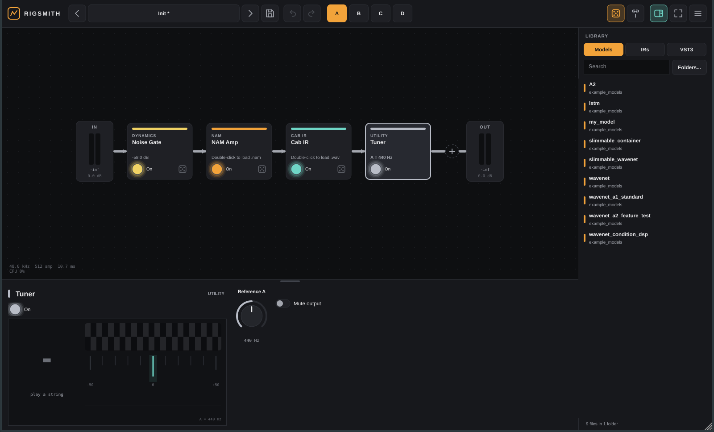
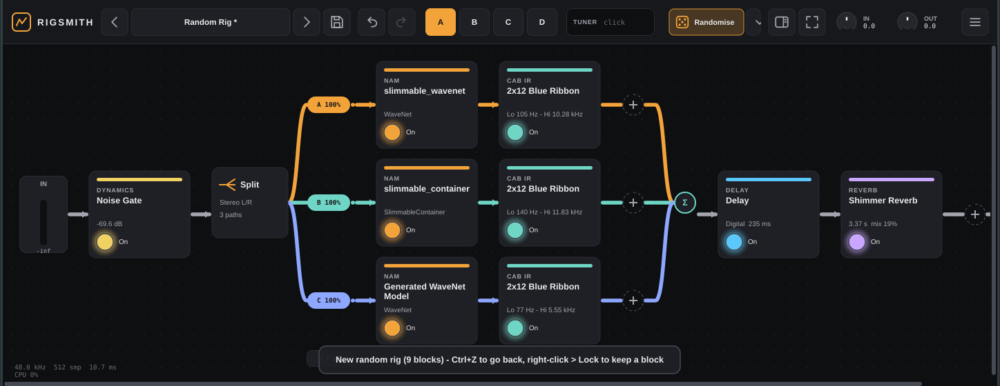

# Rigsmith

A standalone Windows guitar rig built around **Neural Amp Modeler**, with a flexible routing system and a VST3 host — shipped as both **`Rigsmith.exe`** and **`Rigsmith.vst3`** from one codebase.











## Features

**Amp & cab**
- **NAM built in** (NeuralAmpModelerCore): WaveNet, LSTM, ConvNet, A2 and more. Drop a `.nam` file on a block, or double-click it.
- Automatic **resampling** when a model's rate differs from your interface (e.g. a 48 kHz model at 44.1 or 96 kHz).
- **Loudness normalisation** so models are level-matched, plus a post-amp tone stack (bass, middle, treble, presence).
- **Cab IR loader** with low/high cut, mix and level.

**Routing**
- **Splits with up to 6 paths**, nestable to any depth — a split inside a path inside a split.
- Four split modes:
  - **Split %**: one signal shared out; moving one path rebalances the others so the total stays 100%.
  - **Parallel**: every path gets the full signal, with optional auto gain compensation.
  - **Crossover**: Linkwitz-Riley band split (lows / mids / highs), allpass-compensated so it sums flat.
  - **Stereo L/R**: classic wide dual-amp rig.
- Per-path **level, pan, polarity flip, mute and solo**.
- **Automatic latency alignment**: paths with different plug-in latency stay in time, so blends don't comb-filter.
- Wire thickness shows how much signal each path carries.

**Built-in effects** (22 + tuner), each with a live FabFilter-style display of what its knobs are doing
- Dynamics: noise gate, compressor (soft knee, auto makeup, blend), limiter, expander, transient shaper, auto swell
- Drive (2x oversampled): overdrive, fuzz (with octave), clean boost, bit crusher
- EQ & filter: studio EQ with **draggable bands**, wah (pedal / envelope / LFO)
- Modulation: chorus, flanger, phaser, tremolo (incl. harmonic), Uni-Vibe, rotary speaker
- Time: delay (digital / tape / ping-pong / dual, with ducking), reverb (room / hall / plate / spring / shimmer)
- Pitch: octave down / up, pitch shift, doubler
- Utility: tuner, volume / pan
- Displays: filter curves over a live pre/post spectrum, compressor transfer curves with the signal riding on them, waveshaper curves, LFO shapes, echo taps, reverb decay

**Starting points** (top of the preset menu, and first in Page Up / Down)
- **Init**: gate, amp, cab.
- **Classic Rig**: gate → overdrive → NAM amp → cab IR → chorus → delay → plate reverb, the standard pedalboard order.
- **Dual Amp Rig**: the same, with a split into two NAM + IR paths in parallel (panned a little apart, auto gain on the sum).
- They keep the amp and cab you have loaded, or use the first ones in your library (the second amp is the next model in the same folder). Scenes come ready: **Clean**, **Crunch**, **Lead** and **Dry**.

**Randomise** (dice icons)
- **Whole rig** (dice, top bar; right-click for options): dynamics, drives, NAM amps picked from your model folders, cabs from your IR folders, modulation, delays and reverbs, sometimes as a 2- or 3-amp split. Musical ranges, levels never randomised.
- **Lock** blocks you like (lock icon, or right-click) and they survive every roll.
- **Ticks in the library** choose what the dice can pick: untick audio-repair plug-ins, test models, noisy IRs or built-in effects you never use, and they're never chosen. Shift/Ctrl-click to tick several at once, right-click for a whole folder or manufacturer, or search and use **"x / y in dice"** to change everything shown. Saved in `Rigsmith.ini`.
- **Dice on each block** (bottom-right of its card): swaps it for a random block of the same kind (a delay becomes another delay or a delay plug-in, a NAM amp gets another model).
- **Dice in the bottom panel**: randomises the selected block's settings.
- More in the top dice's right-click menu: new blocks in the same layout, randomise every block's settings, include plug-ins, allow splits.
- Everything is one **undo** step (Ctrl+Z / Ctrl+Y, also the arrows in the top bar).

**Workflow**
- **Gain compensation** on any block: like normalising, it measures loudness in vs out while you play, then holds one fixed level match (no pumping). It measures again when you change the block's settings; right-click the button to measure now. The match is saved with the preset.
- **Block presets**: save, load and init any block's settings (bookmark icon). Stored in `Documents\Rigsmith\Block Presets`.
- **Drag to replace**: drop a block, model, IR or plug-in onto the middle of another block to replace it (two blocks swap places); drop near its edge to insert instead.
- **Replace** from the right-click menu too, keeping scenes and footswitch mappings.
- Step through models and IRs in a folder with the `<` `>` buttons.
- **Plug-in parameters in the panel**: every automatable parameter appears as a knob; right-click to pin your favourites.
- **Auto-categorised, colour-coded plug-ins** (Dynamics, Drive, Amp, Cab, EQ, Filter, Modulation, Delay, Reverb, Pitch).
- **Built-in tab** in the library lists every built-in effect by category: drag one onto the rig (or onto a block to replace it), or double-click to add it after the selected block.
- **Rename scenes** by double-clicking them (Enter keeps it, Esc cancels).
- **Audio status** in the top bar: sample rate, buffer, latency, plug-in delay compensation and a CPU meter.
- **Add anywhere**: a small **+** sits on the wire before every block, as well as the big one at the end of each chain.
- **Remembered folders**: several NAM, IR and plug-in folders, set once in **Menu → Settings & folders**.
- **`Rigsmith.ini`** holds your folders, preferences and randomise ticks, and is read every time Rigsmith starts. Rigsmith looks for it next to `Rigsmith.exe` first (a **portable** copy), then in `%APPDATA%\Rigsmith\`, and creates it there if neither exists. Settings has **Show Rigsmith.ini** and **Make this copy portable** buttons. It's plain text, so it's safe to edit or back up. Older settings are brought across automatically.
- **Plug-in scanning**: the first run scans for plug-ins. After that, Rigsmith opens straight away with the remembered list, unless you tick **Look for new plug-ins every time Rigsmith opens** (or click **Scan**).
- Every dB readout is shown to one decimal place.
- **More room**: drag the bar above the bottom panel to make it taller (double-click toggles), hide the library (`L`), and go **full screen** (`F11`, or open full screen every time in Settings).
- **Init** is always the first preset; Page Up / Down steps from Init through your presets.

**Hosting & live use**
- Hosts any **VST3** effect (and VST2 in builds made with the VST2 SDK; see below). Plug-in state is saved in your presets, and a missing plug-in keeps its settings until you reinstall it.
- **Scenes A–D**: per-scene bypass, path levels and mutes, with click-free crossfades.
- **MIDI learn** for footswitches and expression pedals: scenes, bypass, path levels, an A/B amp blend, any knob, next/previous preset, tuner and master volume. Program Change selects presets.
- **Tuner**: the tuning fork in the top bar opens a full-screen tuner (`T`), and **Tuner** is also a block you can put anywhere in the rig, with a strobe, a cents needle, a steadiness history, mute and a 430–450 Hz reference.
- Presets are `.rig` files in `Documents\Rigsmith\Presets`; sub-folders show up as banks.
- **Click IN or OUT** for the input / output panel: stereo peak + RMS meters with peak hold and clip counters, and a level history.
  - Input: gain, balance, source (input 1, input 2, summed or stereo) and polarity flip.
  - Output: master, balance, stereo width (down to mono), and a zero-latency **brickwall limiter** with ceiling and release controls, a gain-reduction meter and a limiting history.

## Download

Every push builds on GitHub Actions. Open the **Actions** tab, pick the latest run, and download **Rigsmith-Windows**. It contains:

- **`Rigsmith-x.y.z-Setup.exe`**: installs the app, adds a Start-menu shortcut and puts the VST3 in `C:\Program Files\Common Files\VST3`.
- **`Rigsmith-x.y.z-windows.zip`**: a portable copy of `Rigsmith.exe` and `Rigsmith.vst3`.

To publish a GitHub Release, push a tag:

```
git tag v0.5.0 && git push origin v0.5.0
```

## Quick start

1. Run Rigsmith. Open **Menu → Audio / MIDI settings**, choose your interface's **ASIO** driver (or WASAPI) and set a small buffer (64–128 samples).
2. Choose your guitar input under **Menu → Guitar input** (input 1 by default).
3. Open **Menu → Settings & folders** and add the folders holding your `.nam` models, IRs and plug-ins. They're remembered from then on. Free models are on [TONE3000](https://www.tone3000.com).
4. Drag a model onto the **NAM Amp** block and an IR onto **Cab IR**.
5. Click **+** anywhere in the chain to add blocks, splits or VST3s. Scan for VST3s first with **Library → VST3 → Scan…**.

### Working with the rig

| Action | How |
|---|---|
| Bypass a block | Click its footswitch, or select it and press `Space` |
| Reorder a block | Drag it, including into or out of a split's paths |
| Set a path's level | Drag its coloured pill up or down, or use the inspector |
| Mute a path | Double-click its pill |
| More options | Right-click any block, pill, scene or knob |
| MIDI learn | Right-click a control, choose **MIDI learn**, then press a footswitch or move a pedal |
| Switch scenes | Keys `1`–`4` |
| Change presets | `Page Up` / `Page Down` (Init, Classic Rig, Dual Amp Rig, then yours) |
| Add a block between two others | Click the small **+** on the wire |
| Save | `Ctrl+S` |
| Tuner | `T` |
| Undo / redo | `Ctrl+Z` / `Ctrl+Y` |
| Randomise selected block / its type / whole rig | `R` / `Shift+R` / `Ctrl+Shift+R` |
| Library / full screen | `L` / `F11` |

### VST2

Steinberg no longer licenses the VST2 SDK, so public builds host VST3 only (most current plug-ins ship a VST3). If you have the SDK (it's inside VST3 SDK zips up to 3.6.x), either:

- build locally with `-DRIGSMITH_VST2_SDK=<folder containing pluginterfaces/vst2.x>`, or
- add a repository secret named `VST2_SDK_URL` pointing at a zip of it, and CI will build with VST2 hosting.

VST2 folders then show up in Settings alongside VST3.

## Building from source

Requirements: CMake 3.25+ and Visual Studio 2022 or later with the C++ workload. JUCE 9 and NeuralAmpModelerCore are downloaded automatically.

```
cmake -S . -B build -A x64
cmake --build build --config Release --target Rigsmith_Standalone Rigsmith_VST3
```

The outputs land in `build/Rigsmith_artefacts/Release/Standalone` and `.../VST3`.

Headless engine tests run on Linux or Windows:

```
cmake -S . -B build -DRIGSMITH_TESTS=ON
cmake --build build --target RigsmithTests
build/RigsmithTests_artefacts/Release/RigsmithTests build/_deps/namcore-src/example_models
```

## Project layout

```
Source/
  Engine/   audio graph: Node, Chain, Split, NAM/IR blocks, 22 built-in effects (Fx.cpp, Dsp.h),
            VST3 hosting, scenes, MIDI, presets, undo, randomiser, tuner (no UI code)
  UI/       look & feel, icons, graph view, inspector + effect displays, I/O panel, library, settings, header
  PluginProcessor.*  /  PluginEditor.*   JUCE glue shared by the exe and the VST3
Tests/      headless engine tests
installer/  Inno Setup script used by CI
```

## Licence

Rigsmith is released under the **GNU AGPLv3** (see `LICENSE`), because it's built on the open-source edition of [JUCE](https://juce.com), which is AGPLv3. Distributing a closed-source build would require a commercial JUCE licence.

NeuralAmpModelerCore is © Steven Atkinson, MIT licence. VST is a registered trademark of Steinberg Media Technologies GmbH.
